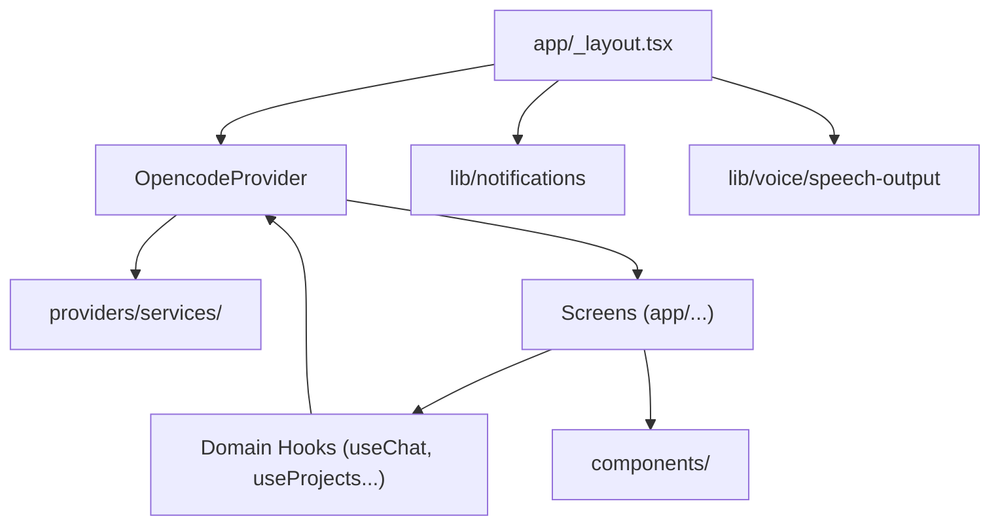

# multiprovider-mobile-to-local-agent

A mobile client (Android, iOS, web) for interacting with a local OpenCode server from your devices.

  


## Features

- Connect to an OpenCode server over authenticated HTTPS, VPN, or secure tunnel.
- Start and continue chat sessions with your local agent.
- Review and approve execution actions from your device.
- Read and edit project text files directly in the app.
- Utilize the project terminal (PTY) on the go.
- Use speech-to-text dictation and hands-free voice mode.

## Architecture



The app uses a simple structural pattern where Expo Router provides navigation, and `OpencodeProvider` owns nearly all domain state and orchestration. Screens are thin and interact with the provider state through narrow domain hooks.

## Quick start

```bash
opencode serve --port 4096
```

Expose the server through authenticated HTTPS, a VPN or a secure tunnel (for
example `cloudflared tunnel --url localhost:4096`), then enter its URL in the
app. Do not expose an unauthenticated port to the internet.

Requires Node `^22.12.0 || ^24.0.0 || >=26.0.0` (see `.nvmrc`).

```bash
npm ci
npm start              # Expo dev server
npm run android        # build and run on Android
npm run ios            # build and run on iOS
npm run web            # run in the browser
```

Checks:

```bash
npm run lint
npm run typecheck
npm run test:vitest
npm run test:ci:static
```

Release builds: `npm run build:android`, `npm run build:foss:android`,
`npm run build:ios:local`. See [docs/development.md](docs/development.md) for
details.

## Configuration

| Environment Variable | Purpose | Default |
| --- | --- | --- |
| `EXPO_APP_VARIANT` | Defines the app variant (e.g. `development`, `foss`) | `production` |
| `EXPO_PUBLIC_FOSS` | Set to `1` to enable the de-Googled FOSS variant | |
| `EXPO_PUBLIC_E2E_MODE` | Set to `1` to enable end-to-end testing mode | |
| `EXPO_PUBLIC_E2E_SERVER_URL` | OpenCode server URL used in E2E tests | |
| `EXPO_APP_NAME` | Name of the app, allows side-by-side test APKs | `OpenCode Mobile` (or `OpenCode Mobile Dev`) |
| `EXPO_ANDROID_PACKAGE` | Android package name | `app.getopencode` (or `app.getopencode.fdroid`) |
| `EXPO_ANDROID_PACKAGE_DEV`| Android dev package name | `app.getopencode.dev` |
| `EXPO_IOS_APP_STORE_ID` | Store listing ID for iOS updates | |
| `EXPO_IOS_APP_STORE_COUNTRY` | Country for iOS store updates | |
| `I18N_ALLOW_MISSING` | Set to `1` to allow missing i18n keys during tests | |
| `OPENCODE_BUILD_FLAVOR` | Build flavor when building Android (e.g. `foss`) | |

## Screenshots

  


## Roadmap

See issues and [docs/known-gaps.md](docs/known-gaps.md).

## License & credits

Apache-2.0, see [LICENSE](LICENSE). Based on opencode-mobile.
